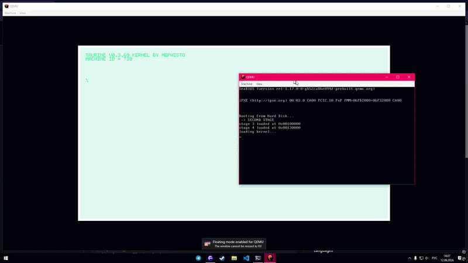
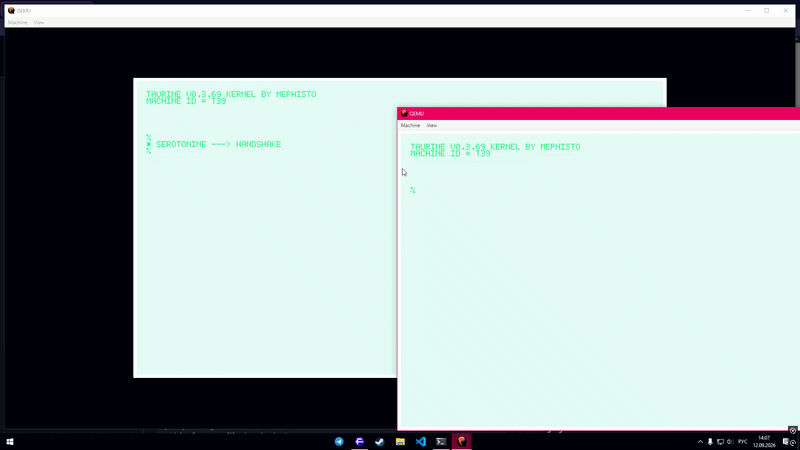
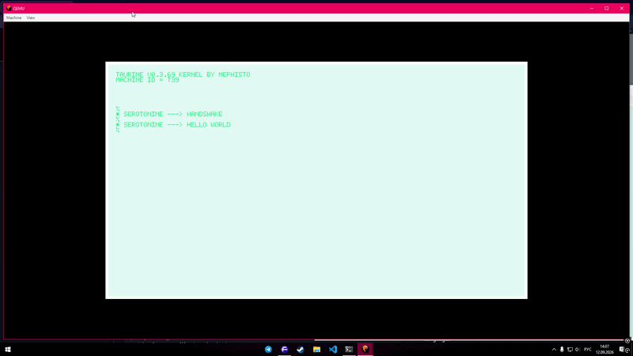

<div align="center">


# Taurine

<p>
  <a href="LICENSE"></a>
  
  
   <a href="https://github.com/FLMxN/taurine/stargazers"></a>

</p>

Experimental operating-system kernel written from scratch in Rust for heterogeneous distributed computation.

</div>

> [!WARNING]
> Taurine is experimental kernel software, not a general-purpose operating system or a production runtime. It is **NOT tested** and **NOT recommended** to boot on bare-metal devices outside of VMs. If you do, feel free to tell us what happened.

## Table of contents

- [Overview](#overview)
  - [Vision](#vision)
  - [Layers at a glance](#layers-at-a-glance)
- [Project layout](#project-layout)
- [Requirements](#requirements)
- [Building](#building)
- [Startup](#startup)
- [Current state](#current-state)
- [Architecture](#architecture)
- [Shell and serial protocol](#shell-and-serial-protocol)
  - [Shell commands](#shell-commands)
  - [Serial messages](#serial-messages)
- [Filesystem and memory primitives](#filesystem-and-memory-primitives)
- [Roadmap](#roadmap)
  - [Kernel foundations](#kernel-foundations)
  - [Molecule](#molecule)
- [Philosophy](#philosophy)
- [Media](#media)
- [License](#license)

## Overview

**Taurine** is an open-source minimal experimental operating-system kernel written from scratch in Rust.

The project is built around a simple idea: **Taurine** is the low-level foundation for **Molecule** — a distributed computing system intended to connect heterogeneous machines and use them as a shared pool of computational resources.

Taurine currently grows from the lowest useful primitives: booting an x86-64 kernel, handling interrupts, drawing to a framebuffer, reading keyboard input, running a small diagnostic shell, and exchanging data between QEMU-emulated nodes over a serial connection.

> [!IMPORTANT]
> The kernel is currently **kernel-space only**. The shell is a diagnostic/interaction interface, **not** a userspace shell.

### Vision

**Molecule** is intended to connect old and heterogeneous computers, potentially across different CPU architectures, and let them cooperate on computation.

The first principle is deliberately simple:

> two **Taurine** nodes should be able to exchange arbitrary data at a very low level.

From there, higher-level distributed functionality can be built incrementally:

```text
              Orchestrator machine 
                       │
                    Molecule
                       │
          ┌────────────┴────────────┐
          │                         │
       Taurine                    Taurine
          │                         │
   ┌──────┴──────┐           ┌──────┴──────┐
   │ memory      │           │ memory      │
   │ storage     │           │ storage     │
   │ devices     │           │ devices     │
   │ tasks       │           │ tasks       │
   │ transport   │           │ transport   │
   └─────────────┘           └─────────────┘
```

### Layers at a glance

| Layer | Component | Responsibility |
|---|---|---|
| **Molecule** | future | Distributed computation across heterogeneous nodes |
| **Molecule protocol** | future | Framing, messaging, resource discovery, task execution |
| **Taurine transport** | `serotonine.rs` | COM1 UART and QEMU serial/TCP transport experiments |
| **Taurine core** | `taurine.rs`, `noradrenaline.rs` | Boot, IDT/PIC, timer, keyboard interrupts |
| **Interaction** | `glutamate.rs`, `nicotine.rs` | Framebuffer output, keyboard input, diagnostic shell |
| **Storage** | `dopamine.rs` | In-memory FAT filesystem helpers |
| **Memory primitives** | `glucose.rs` | Freestanding `memset`, `memcpy`, `memcmp`, `memchr` |

The implementation intentionally grows from the lowest useful primitive rather than attempting to reproduce a conventional desktop operating system.

## Project layout

```text
taurine/
├── kernel/
│   ├── src/
│   │   ├── electrons/
│   │   │   ├── dopamine.rs
│   │   │   ├── glutamate.rs
│   │   │   ├── mod.rs
│   │   │   ├── nicotine.rs
│   │   │   └── serotonine.rs
│   │   └── nucleus/
│   │       ├── glucose.rs
│   │       ├── mod.rs
│   │       ├── noradrenaline.rs
│   │       └── taurine.rs
│   ├── target/
│   ├── build.rs
│   ├── Cargo.lock
│   ├── Cargo.toml
│   └── rust-toolchain.toml
├── media/
│   ├── boot.gif
│   ├── msg.gif
│   └── shell.gif
├── spawn/
│   ├── .cargo/
│   ├── src/
│   │   └── main.rs
│   ├── target/
│   ├── .env
│   ├── build.rs
│   ├── Cargo.lock
│   ├── Cargo.toml
│   └── rust-toolchain.toml
├── .gitignore
├── LICENSE
└── README.md
```

| Path | Function |
|---|---|
| `kernel/src/nucleus/taurine.rs` | Main kernel module and core wiring |
| `kernel/src/nucleus/noradrenaline.rs` | IDT, PIC initialization, timer and keyboard interrupt handlers |
| `kernel/src/nucleus/glucose.rs` | Freestanding memory primitives: `memset`, `memcpy`, `memcmp`, `memchr` |
| `kernel/src/electrons/glutamate.rs` | Framebuffer writer, font rendering, keyboard scancode handling, command buffer |
| `kernel/src/electrons/nicotine.rs` | Shell command execution, FAT read/write helpers, `POKE`, `MSG`, `PING`, `UPTIME`, `MEMTOTAL`, `FAINT` |
| `kernel/src/electrons/serotonine.rs` | COM1 UART setup, serial polling, handshake, outgoing/incoming messages |
| `kernel/src/electrons/dopamine.rs` | In-memory FAT filesystem helpers: `recall` and `internalize` |
| `spawn/src/main.rs` | Bootable image construction component |

## Requirements

| Requirement | Details |
|---|---|
| **Rust** | **Nightly** Rust and Cargo |
| **Toolchain files** | `kernel/rust-toolchain.toml` and `spawn/rust-toolchain.toml` |
| **QEMU** | Recommended for development and testing; examples use `qemu-system-x86_64` |
| **Host OS** | QEMU keyword arguments and host OS choice are up to the user/developer; examples use Windows PowerShell |

The project contains separate `kernel` and `spawn` components. The `spawn` component produces the bootable image used during development.

## Building

> [!IMPORTANT]
> The kernel is built with **nightly** Rust and Cargo.

Build the image with:

```powershell
cd spawn
cargo build
cd ..
```

Then emulate the image according to the [Startup](#startup) section.

QEMU is highly recommended for development and testing.

## Startup

QEMU can be used to emulate two Taurine nodes connected through a serial TCP endpoint. For example, on a Windows host:

Wake the **master** first:

```powershell
qemu-system-x86_64.exe `
  -drive format=raw,file=.\taurine.img `
  -serial tcp:127.0.0.1:4555,server=on,wait=off
```

Then wake the **slave**:

```powershell
qemu-system-x86_64.exe `
  -drive format=raw,file=.\taurine.img `
  -serial tcp:127.0.0.1:4555
```



Both instances use the same kernel image. Their role is determined by the QEMU serial connection mode.

> [!NOTE]
> This setup is primarily a development/emulation environment. A real UART connection provides bidirectional serial communication; other physical transports will be added later.

## Current state

Taurine currently has:

| Capability | Status |
|---|---|
| x86-64 boot and kernel entry | ✅ |
| Framebuffer output | ✅ |
| Machine ID generation | ✅ |
| Interrupt descriptor table | ✅ |
| PIC initialization | ✅ |
| Timer interrupts | ✅ |
| Keyboard interrupts | ✅ |
| Small interactive shell | ✅ |
| Command argument parsing | ✅ |
| In-memory filesystem | ✅ |
| Low-level serial communication experiments | ✅ |
| QEMU master/slave node emulation | ✅ |
| Block device filesystem | ❌ |
| Executable loading | ❌ |
| Processes/tasks | ❌ |
| Memory management | ❌ |
| Userspace | ❌ |

The kernel is currently **kernel-space only**. The shell is a diagnostic/interaction interface, **not** a userspace shell.

Filesystem and persistent storage are the next major subsystem.

## Architecture

The project is currently developed around x86-64, while Molecule is intended to be architecture-independent at the protocol level.

The eventual model is:

```text
              Taurine core
             /     |      \
        x86-64   AArch64   RISC-V
             \     |      /
          common wire protocol
                    │
             Molecule network
```

Architecture-specific hardware support should remain below the common communication and distributed-computing layers.

## Shell and serial protocol

### Shell commands

The diagnostic shell parses commands in `nicotine.rs`. Commands with arguments use `=`; file writes additionally split path and content by the first space.



| Command | Form | Behavior |
|---|---|---|
| `MSG` | `MSG=<text>` | Sends `MSG=<machine-id>=<text>\n` over serial |
| `WRITE` | `WRITE=<path> <content>` | Writes content to a file through the in-memory FAT helper |
| `READ` | `READ=<path>` | Reads a file and prints its content |
| `POKE` | `POKE=<address> <value>` | Writes an aligned `u64` to a memory address; decimal and `0x` hex are accepted |
| `FAINT` | `FAINT` | Attempts QEMU/ACPI shutdown and halts |
| `MEMTOTAL` | `MEMTOTAL` | Sums usable memory regions reported by the bootloader |
| `UPTIME` | `UPTIME` | Prints kernel lifetime |
| `PING` | `PING` | Sends `PING\n` over serial and returns `PONG` locally |

### Serial messages

Serial communication is line-oriented and newline-terminated. Incoming lines are parsed in `serotonine.rs`.

| Incoming message | Action |
|---|---|
| `HANDSHAKE=<id>` | Displays `HANDSHAKE W/ <id>` |
| `PING` | Displays `PONG` |
| `MSG=<id>=<message>` | Displays `<id> said: <message>` |



## Filesystem and memory primitives

The current filesystem layer is an **in-memory FAT12** built over a byte buffer:

```rust
pub struct FATBuffer<'a>(pub Cursor<&'a mut [u8]>);
```

`dopamine.rs` provides:

| Function | Purpose |
|---|---|
| `recall` | Reads a file from the FAT filesystem into an output buffer |
| `internalize` | Creates/truncates a file and writes contents into it |

`glucose.rs` provides freestanding memory functions required by the kernel environment:

| Function | Purpose |
|---|---|
| `memset` | Fill memory with a byte value |
| `memcpy` | Copy bytes between memory regions |
| `memcmp` | Compare byte sequences |
| `memchr` | Find a byte in a memory region |

Persistent block-device storage is not implemented (yet).

## Roadmap

The roadmap is capability-driven rather than a strict conventional OS-development checklist.

### Kernel foundations

- [x] boot into a Rust kernel
- [x] framebuffer output
- [x] IDT and interrupt handling
- [x] timer
- [x] keyboard input
- [x] interactive shell
- [x] command arguments
- [x] in-memory filesystem
- [ ] block device filesystem
- [ ] executable loading
- [ ] processes/tasks
- [ ] memory management
- [ ] userspace

### Molecule

- [x] exchange data between kernel instances in QEMU
- [x] node discovery / handshake
- [x] bidirectional transport abstraction
- [ ] framing and message protocol
- [ ] heterogeneous architecture support
- [ ] distributed task execution
- [ ] resource discovery
- [ ] distributed ML workloads

The exact order may change as the kernel evolves.

## Philosophy

Taurine is intentionally small and experimental.

There is no goal of implementing every feature expected from a conventional Unix-like operating system. Subsystems should exist because they enable something the project actually needs.

If a scheduler is not needed yet, there is no reason to build one merely because operating systems normally have schedulers. If a filesystem becomes necessary for persistent state and executable loading, then the filesystem gets built.

The objective is to understand and control the entire stack — from boot and interrupts to communication and eventually distributed computation.


## License

GNU General Public License v3.0. See [`LICENSE`](LICENSE).